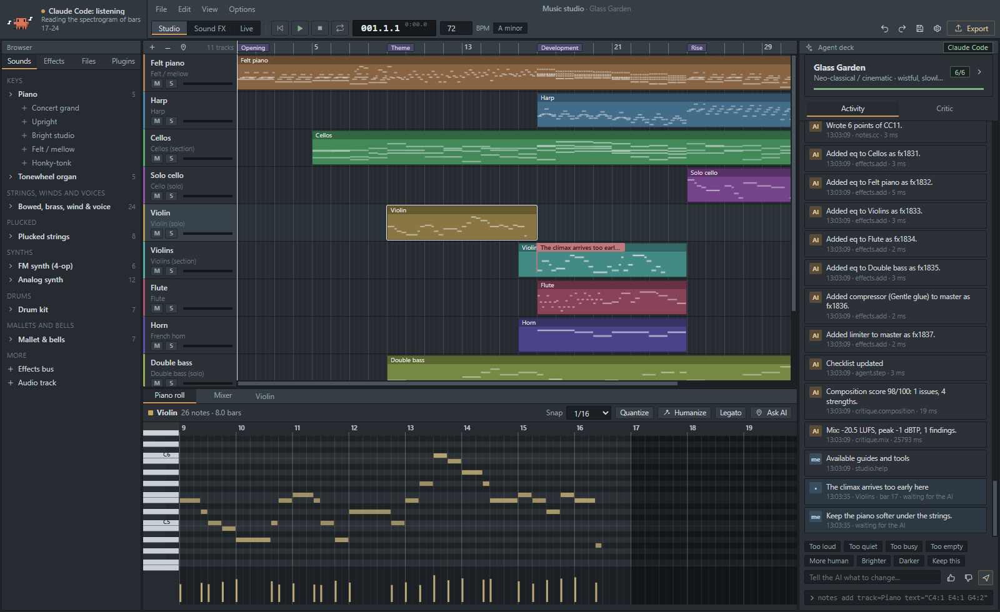
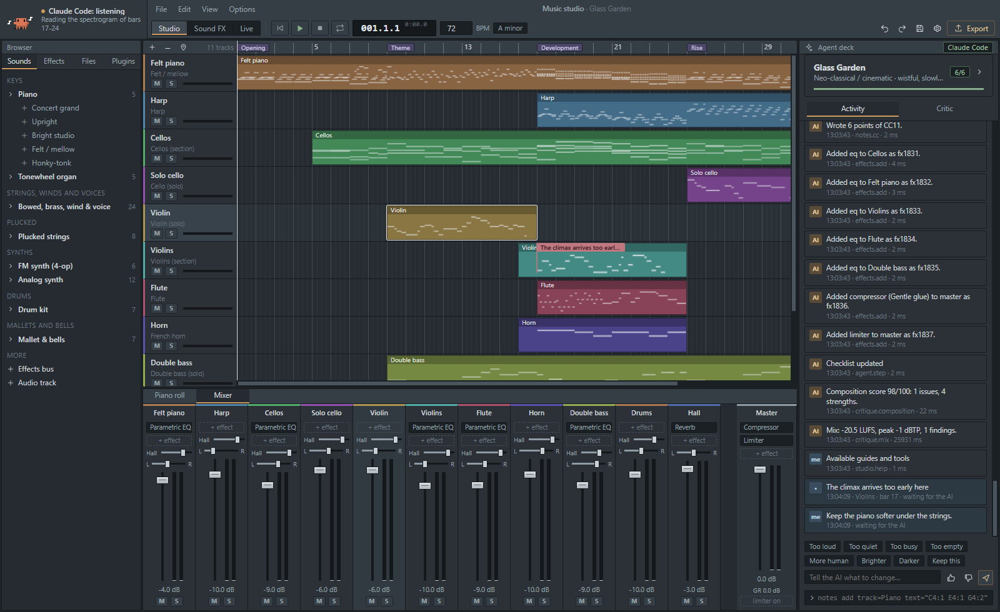
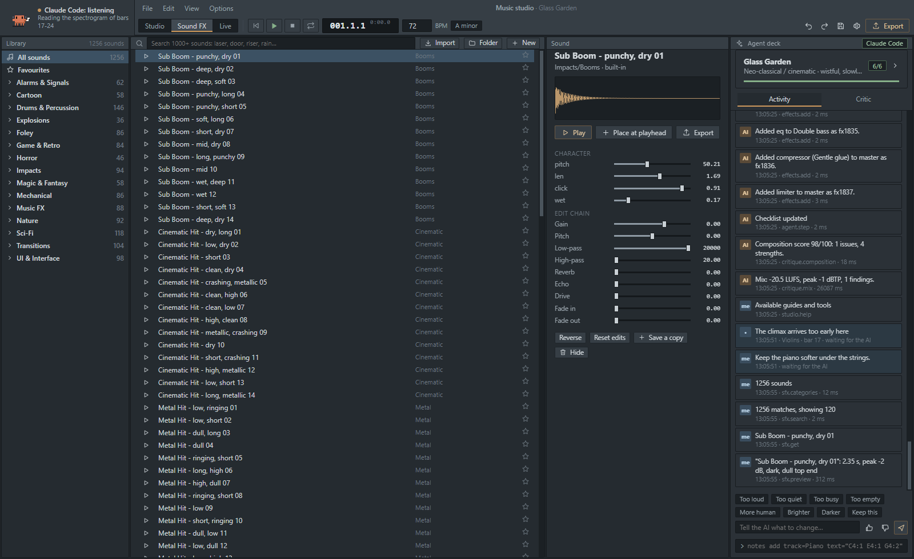
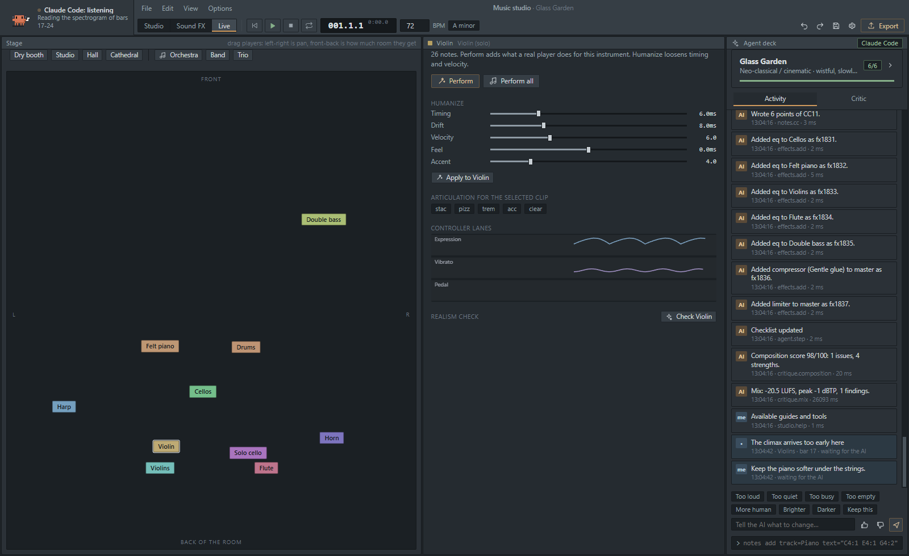
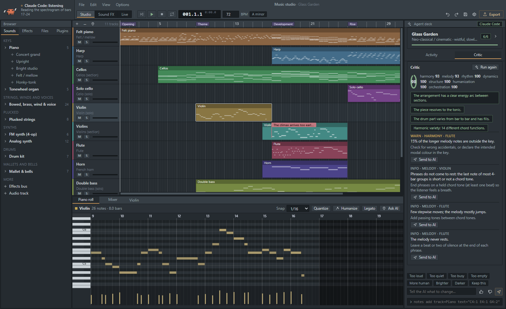
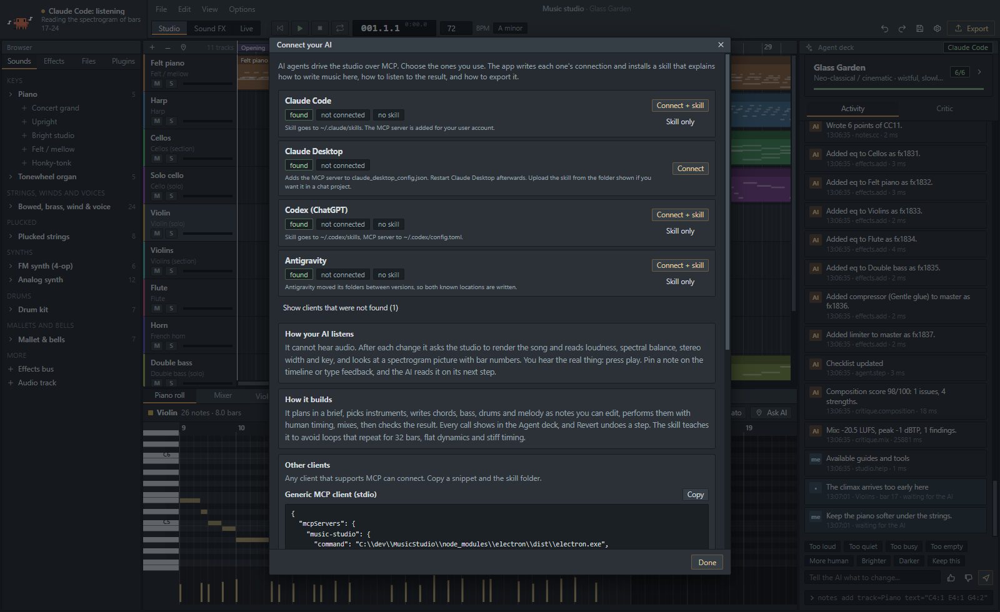
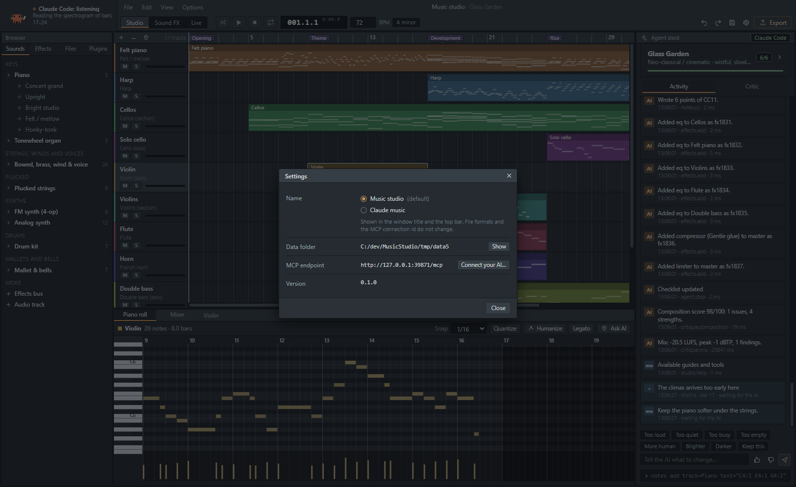
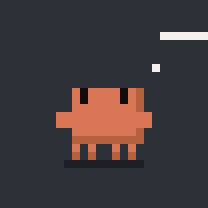
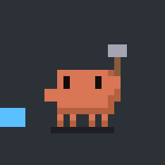

# Music studio

A desktop DAW with its own audio engine, built so an AI agent can compose, edit, listen, mix and export through MCP while a person watches, listens and corrects it.

The engine synthesizes every sound itself: physical models, source-filter voices, FM, subtractive synths, a drum kit and 1256 sound effects. **FFmpeg never generates audio here.** It only decodes and encodes files. [`docs/comparison`](docs/comparison/README.md) shows what FFmpeg alone produces from the same notes.

> Russian version: [README.ru.md](README.ru.md)



## Screens

| | |
|---|---|
|  |  |
| Mixer: strips, sends, sidechain, meters | Sound FX: 1256 effects, parameters and an edit chain |
|  |  |
| Live: stage, humanize, articulations, controller lanes | The critic's notes, each with Send to AI |
|  |  |
| Connect your AI: client detection and the skill | Settings: the name switch (Music studio / Claude music) |

Video: [docs/media/demo.mp4](docs/media/demo.mp4). An agent builds Glass Garden through tool calls, listens, answers a pin and a message, and the climax plays.

Clawd's states, in the order the status indicator uses them:

| asleep | idle | thinking | building | loading | listening | mixing |
|---|---|---|---|---|---|---|
|  |  |  |  |  |  |  |

## What is in it

**Music.** Timeline, MIDI clips, piano roll, a 77-preset instrument set on 9 engines, mixer with buses, sends and sidechain, 16 effects, automation, tempo map, markers. Import WAV, MP3, FLAC and MIDI; MP3, OGG, M4A and others go through FFmpeg decoding. Export WAV, FLAC, MP3 and MIDI (OGG, M4A, Opus when FFmpeg is installed), plus stems.

**Sound effects.** 1256 built-in effects in categories and folders (Impacts, Sci-Fi, Foley, Nature, UI, Transitions and more). Preview each one, edit its parameters and an effect chain, import your own files or folders, add new ones, hide or delete, place on the timeline, export.

**Live.** A stage view and a performance panel. Each instrument gets a seat on the stage (pan and room), humanize settings, articulations (staccato, pizzicato, tremolo, accent) and controller lanes for expression, vibrato and pedal. A realism check flags parts that sound mechanical.

**For the AI.** An MCP server with 19 tools and 115 actions: [`docs/mcp-tools.md`](docs/mcp-tools.md). The agent writes a brief, builds parts from theory tools (progressions, voice leading, melody from a motif, bass and drum patterns), performs them with human timing, mixes, then **listens**: loudness, spectrum, stereo, key and tempo, a spectrogram picture with bar numbers, and a critic that checks harmony, melody, rhythm, dynamics, form and the mix. The status of the agent shows top left as Clawd: asleep, ready, thinking, building, loading, listening with headphones, mixing.

**For the person.** Everything the agent does appears in the Agent deck as it happens, with a Revert button. You can pin a note on the timeline ("violin enters too early here"), type feedback, rate, or edit blocks and notes yourself. The agent reads all of it on its next step.

## Music made through the tool calls

Each piece below was written by a script that makes the same calls an agent makes over MCP (see [`examples/`](examples/)). Nobody edited the audio.

| Piece | Style | Listen | Source |
|---|---|---|---|
| Glass Garden | Neo-classical, A minor, 72 bpm | [mp3](examples/music/glass-garden.mp3) · [midi](examples/music/glass-garden.mid) | [glass-garden.mjs](examples/glass-garden.mjs) |
| Night Tram | Lo-fi jazz, D minor, 76 bpm | [mp3](examples/music/night-tram.mp3) · [midi](examples/music/night-tram.mid) | [night-tram.mjs](examples/night-tram.mjs) |
| Static Bloom | Melodic house, A minor, 124 bpm | [mp3](examples/music/static-bloom.mp3) · [midi](examples/music/static-bloom.mid) | [static-bloom.mjs](examples/static-bloom.mjs) |
| Sound effects reel | 40 effects from the library | [mp3](examples/music/sfx-reel.mp3) | [sfx-reel.mjs](examples/sfx-reel.mjs) |

Each piece also has a `.report.json` with the loudness, spectrum and critic output that the agent saw, and a `.png` spectrogram. The author of this repository could not listen to the music while writing it; the reports are what the build was checked against. Judge by ear.

## FFmpeg versus the engine

The same notes, rendered by the engine and by FFmpeg's own signal sources (sine tones, five-harmonic tones with a decay, noise for drums). Spectrograms, numbers and audio are in [`docs/comparison`](docs/comparison/README.md).

## Connect an AI

The first run offers to connect your AI clients and install the skill that tells them how to compose, listen and mix here. Options > Connect your AI does the same later. It writes the MCP entry and copies the skill folder for:

- Claude Code (`~/.claude/skills`)
- Claude Desktop (MCP entry; upload the skill from the folder shown)
- Codex / ChatGPT (`~/.codex/skills`, MCP in `config.toml`)
- Antigravity (both known skill locations)
- any other MCP client, with copy-paste snippets

The skill is in [`skills/music-studio`](skills/music-studio/SKILL.md). The server runs on `127.0.0.1` with a bearer token and Host/Origin checks; a stdio bridge (`npm run mcp`) connects to the running app, or works headless when the app is closed.

## Run it

Needs Node 22.18 or newer (Node 24 recommended) and, optionally, FFmpeg on `PATH` for OGG, M4A and Opus.

```bash
git clone https://github.com/LOLXD-hub/music-studio.git
cd music-studio
npm install
npm start
```

```bash
npm test          # engine, theory, studio flow, MCP over HTTP
npm run docs      # regenerate docs/mcp-tools.md from the tool definitions
npm run dist      # portable Windows build
```

Settings has the name switch: the app is called "Music studio" by default and can be shown as "Claude music".

## How it is built

- Electron, Preact and esbuild for the app. TypeScript runs directly on Node (type stripping, no transpile step for the engine, tools and tests).
- One `Engine` class renders audio. In the app it runs inside an AudioWorklet; for export, analysis and the agent's "listening" it runs offline in a worker thread. What you hear is what you export.
- The studio state lives in the main process. Every change, from the UI or from MCP, is one atomic mutation with undo, a patch to the UI and an entry in the activity feed.
- More: [`docs/architecture.md`](docs/architecture.md).

## Limits

- Instruments are synthesized. They are convincing for what they are (inharmonic piano strings, bowed legato, brass brightness that follows dynamics), but they are not recordings. For recorded sounds, load WAV samples into a sampler track.
- VST3 plugins are scanned and listed. They are not hosted yet; that needs a separate plugin-host process.
- No SoundFont (SF2) loader yet.
- The agent cannot hear. It reads numbers and pictures. A person should listen before trusting a mix.
- Only tested on Windows 10. The code has no Windows-only parts except the portable build target.

## Not affiliated

This is an independent project. It is not made by, endorsed by or connected to Anthropic or Image-Line. "FL Studio" is a trademark of Image-Line; this app borrows the idea of a familiar DAW layout, not its code or assets. Clawd is drawn here as pixel art for the status indicator.

## License

MIT. See [LICENSE](LICENSE).
