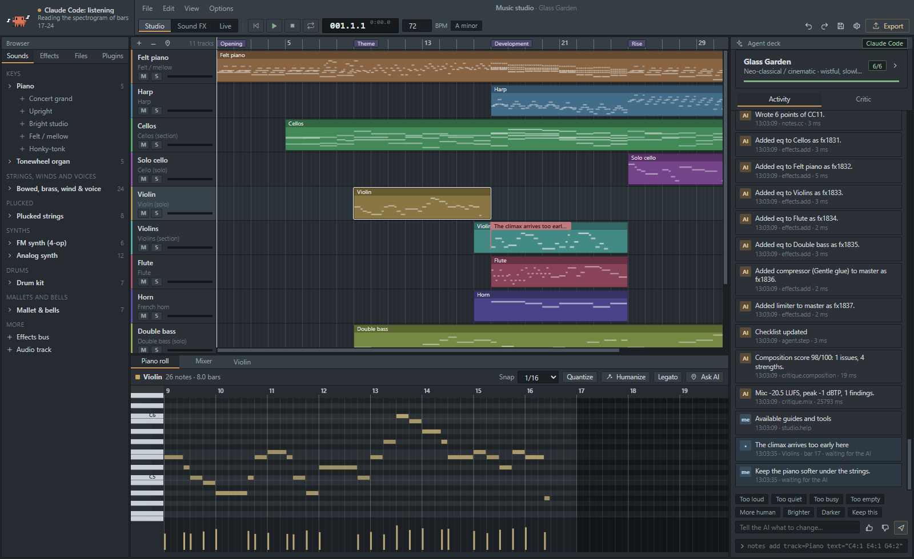
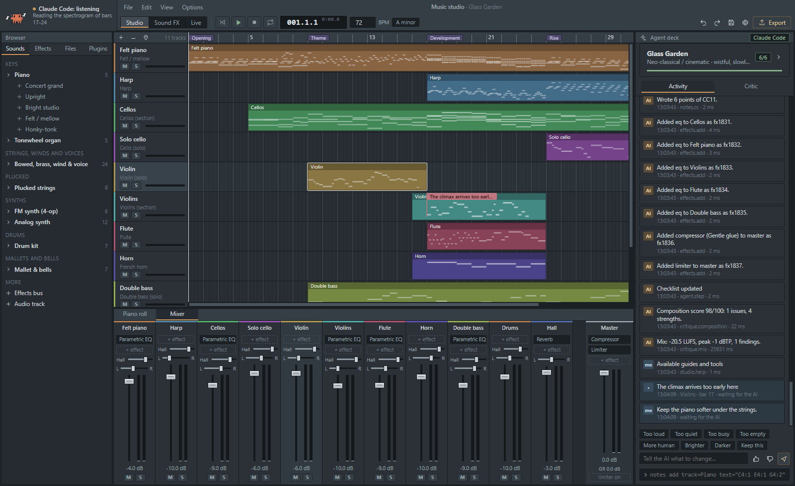
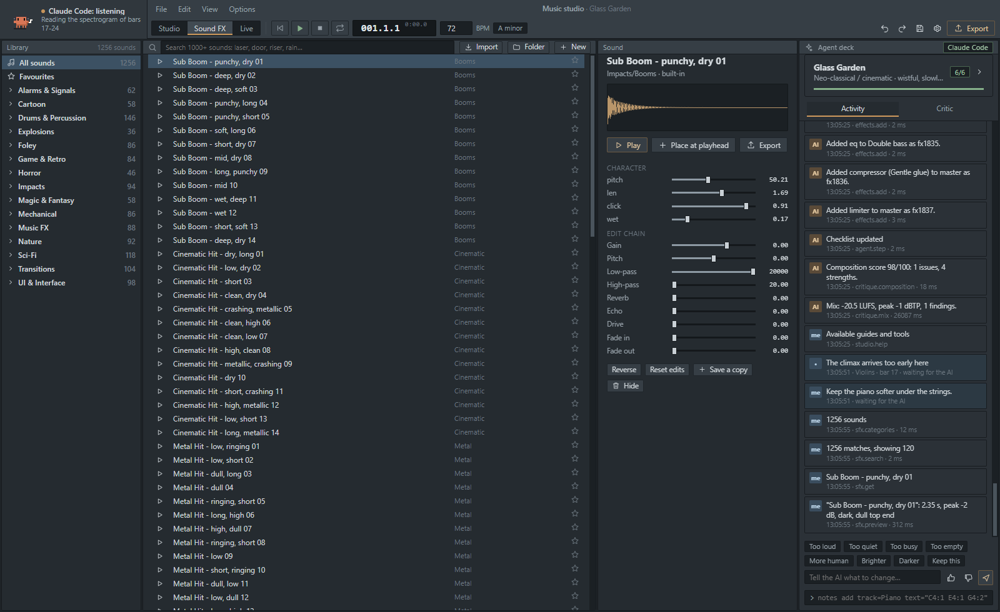
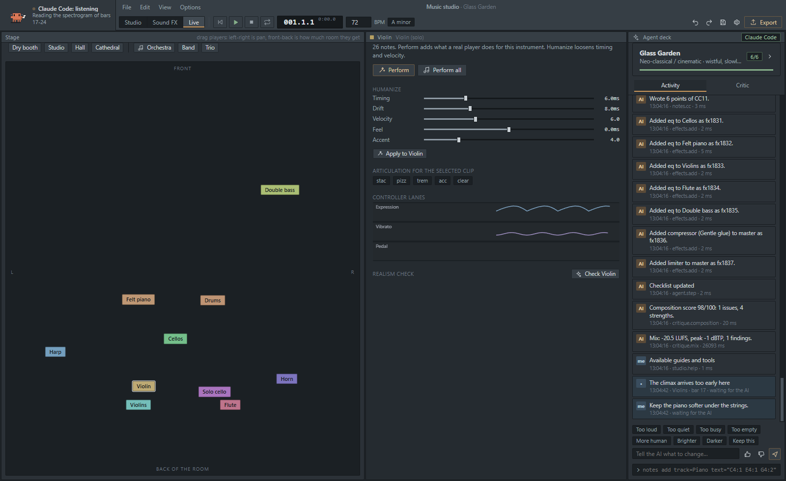
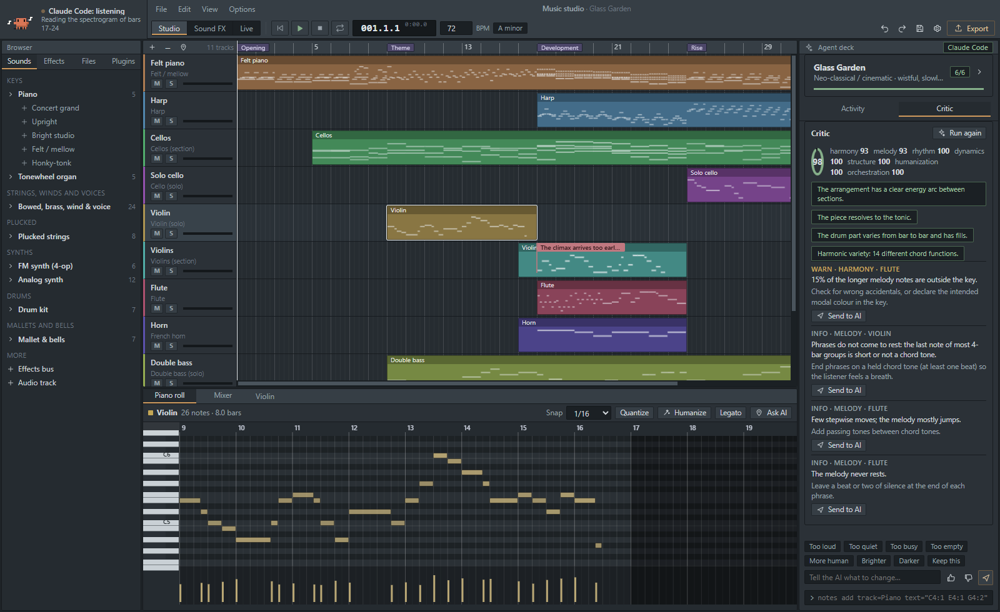
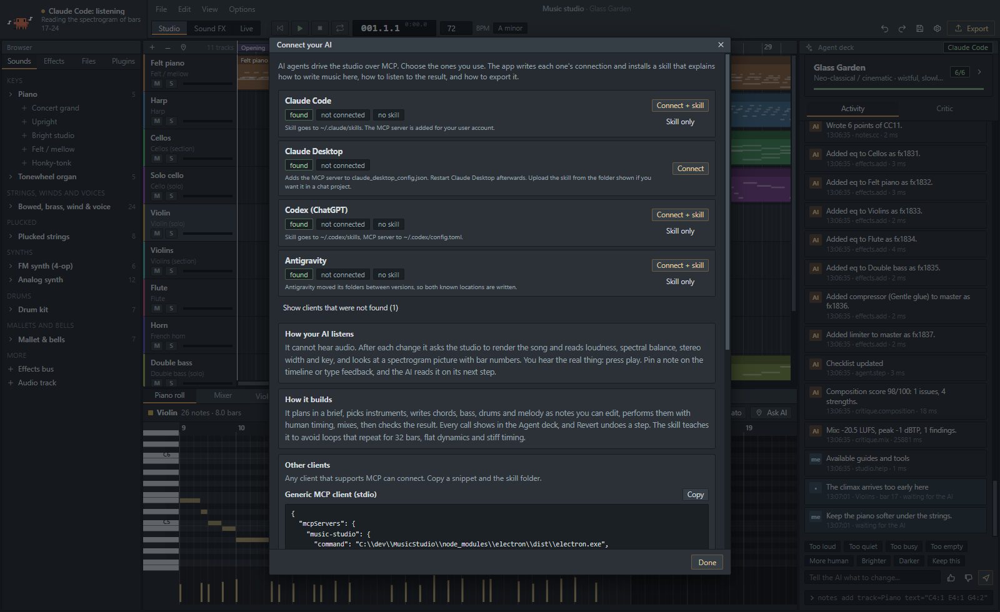
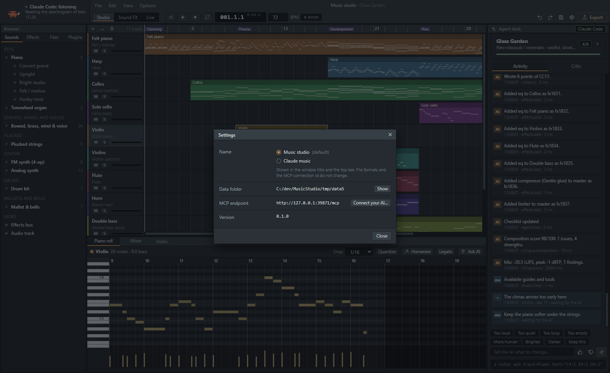
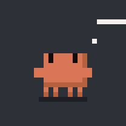
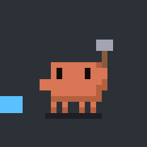

# Music studio

Настольная DAW со своим аудиодвижком. Через MCP её может вести ИИ-агент: сочинять, править, слушать, сводить и экспортировать. Человек в это время смотрит, слушает и поправляет.

Все звуки синтезирует движок: физические модели, source-filter голоса, FM, вычитающие синтезаторы, ударная установка и 1256 звуковых эффектов. **FFmpeg здесь ничего не генерирует.** Он только читает и записывает файлы. Что получается из тех же нот на одном FFmpeg, показано в [`docs/comparison`](docs/comparison/README.md).

> English: [README.md](README.md)



## Экраны

| | |
|---|---|
|  |  |
| Микшер: каналы, посылы, сайдчейн, индикаторы | Sound FX: 1256 эффектов, параметры и цепочка обработки |
|  |  |
| Live: сцена, живость, артикуляции, контроллеры | Замечания критика, у каждого кнопка Send to AI |
|  |  |
| Connect your AI: поиск клиентов и скилл | Настройки: переключатель названия (Music studio / Claude music) |

Видео: [docs/media/demo.mp4](docs/media/demo.mp4). Агент строит Glass Garden вызовами инструментов, слушает, отвечает на метку и сообщение, затем звучит кульминация.

Состояния Clawd в порядке индикатора статуса:

| спит | ждёт | думает | строит | загружает | слушает | сводит |
|---|---|---|---|---|---|---|
|  |  |  |  |  |  |  |

## Что внутри

**Музыка.** Таймлайн, MIDI-клипы, piano roll, 77 пресетов на 9 движках, микшер с шинами, посылами и сайдчейном, 16 эффектов, автоматизация, карта темпа, маркеры. Импорт WAV, MP3, FLAC и MIDI (OGG, M4A и другие читаются через FFmpeg). Экспорт в WAV, FLAC, MP3 и MIDI, а также стемы.

**Звуковые эффекты.** 1256 встроенных эффектов по категориям и папкам: удары, sci-fi, фоли, природа, интерфейс, переходы и другие. Каждый можно прослушать, поменять параметры и цепочку обработки, добавить свой файл или папку, создать новый, скрыть или удалить, поставить на таймлайн и экспортировать.

**Live.** Сцена и панель исполнения. У каждого инструмента своё место на сцене (панорама и комната), настройки «живости», артикуляции (стаккато, пиццикато, тремоло, акцент) и дорожки контроллеров: экспрессия, вибрато, педаль. Проверка реализма показывает партии, которые звучат механически.

**Для ИИ.** MCP-сервер: 19 инструментов, 115 действий ([`docs/mcp-tools.md`](docs/mcp-tools.md)). Агент пишет бриф, собирает партии из теории (гармония, голосоведение, мелодия из мотива, басовые и ударные паттерны), исполняет их с человеческим таймингом, сводит и **слушает**: громкость, спектр, стерео, тональность и темп, спектрограмма с номерами тактов, критик гармонии, мелодии, ритма, динамики, формы и микса. Состояние агента видно слева сверху: Clawd спит, ждёт, думает, строит, загружает, слушает в наушниках, сводит.

**Для человека.** Всё, что делает агент, появляется в Agent deck по мере выполнения, с кнопкой Revert. Можно поставить метку на таймлайне («здесь скрипка входит рано»), написать сообщение, поставить оценку или править блоки и ноты самому. Агент прочитает это на следующем шаге.

## Музыка, написанная вызовами инструментов

Каждая вещь ниже написана скриптом, который делает те же вызовы, что агент по MCP (см. [`examples/`](examples/)). Звук никто не правил вручную.

| Вещь | Стиль | Слушать | Код |
|---|---|---|---|
| Glass Garden | Неоклассика, ля минор, 72 bpm | [mp3](examples/music/glass-garden.mp3) · [midi](examples/music/glass-garden.mid) | [glass-garden.mjs](examples/glass-garden.mjs) |
| Night Tram | Лоу-фай джаз, ре минор, 76 bpm | [mp3](examples/music/night-tram.mp3) · [midi](examples/music/night-tram.mid) | [night-tram.mjs](examples/night-tram.mjs) |
| Static Bloom | Мелодик-хаус, ля минор, 124 bpm | [mp3](examples/music/static-bloom.mp3) · [midi](examples/music/static-bloom.mid) | [static-bloom.mjs](examples/static-bloom.mjs) |
| Ролик эффектов | 40 эффектов из библиотеки | [mp3](examples/music/sfx-reel.mp3) | [sfx-reel.mjs](examples/sfx-reel.mjs) |

У каждой вещи есть `.report.json` с тем, что видел агент (громкость, спектр, вывод критика), и спектрограмма `.png`. Автор не мог слушать музыку, пока писал её: сборка проверялась по этим отчётам. Судите на слух.

## FFmpeg и движок

Одни и те же ноты, отрисованные движком и штатными источниками сигнала FFmpeg (синусы, пятигармонические тона с затуханием, шум для барабанов). Спектрограммы, цифры и аудио: [`docs/comparison`](docs/comparison/README.md).

## Подключить ИИ

При первом запуске приложение предлагает подключить ваши ИИ-клиенты и установить скилл: он объясняет, как здесь сочинять, слушать и сводить. То же самое делает Options > Connect your AI. Приложение пишет запись MCP и копирует папку со скиллом для:

- Claude Code (`~/.claude/skills`)
- Claude Desktop (запись MCP; скилл загрузите из показанной папки)
- Codex / ChatGPT (`~/.codex/skills`, MCP в `config.toml`)
- Antigravity (обе известные папки для скиллов)
- любого другого MCP-клиента, через готовые фрагменты конфигурации

Скилл лежит в [`skills/music-studio`](skills/music-studio/SKILL.md). Сервер слушает `127.0.0.1`, требует токен и проверяет заголовки Host и Origin. Мост stdio (`npm run mcp`) подключается к запущенному приложению или работает без него.

## Запуск

Нужен Node 22.18 или новее (лучше 24) и, по желанию, FFmpeg в `PATH` для OGG, M4A и Opus.

```bash
npm install
npm start
```

```bash
npm test          # движок, теория, студия, MCP по HTTP
npm run docs      # пересобрать docs/mcp-tools.md из определений инструментов
npm run dist      # портативная сборка для Windows
```

В настройках есть переключатель названия: по умолчанию приложение называется «Music studio», его можно показывать как «Claude music».

## Устройство

- Приложение: Electron, Preact, esbuild. TypeScript движка, инструментов и тестов исполняется напрямую в Node (без шага компиляции).
- Звук считает один класс `Engine`. В приложении он работает в AudioWorklet, для экспорта, анализа и «слуха» агента тот же класс работает офлайн в рабочем потоке. Что слышно, то и экспортируется.
- Состояние студии живёт в главном процессе. Любое изменение, из интерфейса или по MCP, это одна атомарная мутация с отменой, патчем для интерфейса и записью в ленте.
- Подробнее: [`docs/architecture.md`](docs/architecture.md).

## Ограничения

- Инструменты синтезированные. Они убедительны для синтеза (негармоничные струны рояля, смычковое легато, яркость меди от динамики), но это не записи. Для записанных звуков загрузите WAV-сэмплы в дорожку сэмплера.
- VST3-плагины сканируются и перечисляются, но не загружаются: для этого нужен отдельный процесс-хост плагинов.
- Загрузчика SoundFont (SF2) пока нет.
- Агент не слышит. Он читает числа и картинки. Прежде чем доверять миксу, его должен послушать человек.
- Проверялось только на Windows 10.

## Не связано

Это независимый проект. Он не создан, не одобрен и не связан с Anthropic или Image-Line. «FL Studio» — товарный знак Image-Line; здесь взята только идея привычной раскладки DAW, без кода и ресурсов. Clawd нарисован как пиксель-арт для индикатора состояния.

## Лицензия

MIT, см. [LICENSE](LICENSE).
