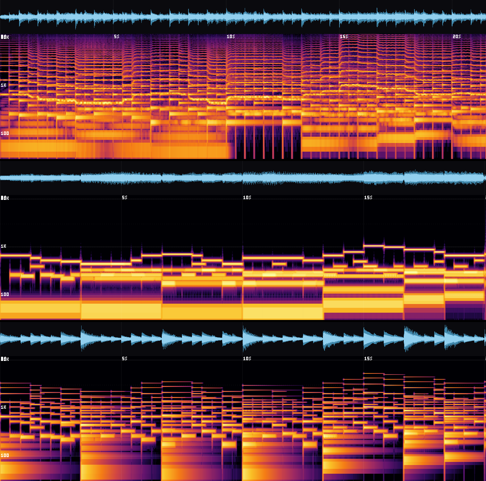
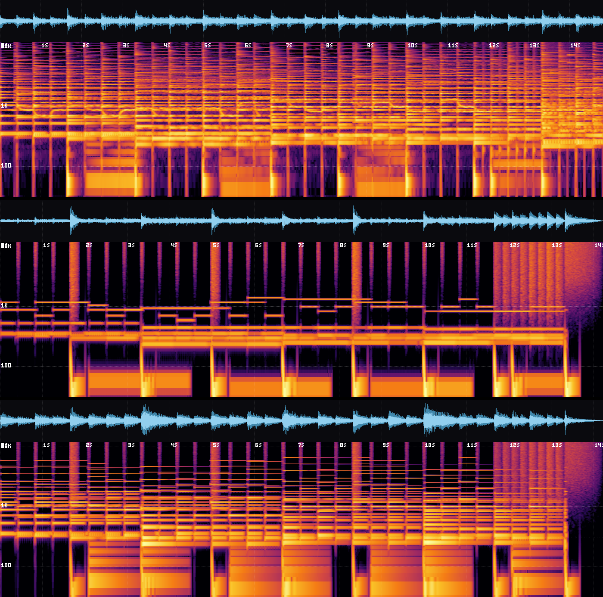

# FFmpeg versus the engine

The same notes, rendered three ways. This is the comparison that explains the rule in this project: **FFmpeg decodes and encodes files, and nothing else.**

- **Engine**: the app's own synthesis, exactly what you hear in the app and get from an export.
- **FFmpeg, sine tones**: one `sine` source per note, a fade in and out, `adelay` to place it, `amix` to mix.
- **FFmpeg, 5-harmonic tones**: the strongest plain-FFmpeg version we could write. Each note is an `aevalsrc` expression with five harmonics and an exponential decay. Drums are an `aevalsrc` sine sweep for the kick and `anoisesrc` with a high-pass for snare, hats and cymbals.

Both FFmpeg versions get the same pitches, start times, lengths and velocities as the engine, taken from the performed Glass Garden project (so even the human timing is the same). Only the sound source differs. Each file is normalized to -16 LUFS so loudness does not decide the listening test. The script is [`tools/compare-ffmpeg.ts`](../../tools/compare-ffmpeg.ts); the generated filtergraph for one excerpt is in this folder ([strings and piano](strings-piano-additive.filtergraph.txt), [full, with drums](full-with-drums-additive.filtergraph.txt)). Run `npm run compare` to rebuild everything.

This is a baseline written to be fair, not the best FFmpeg could ever do. With much more work (filters for body resonance, `aecho` for a room, detuned layers) it gets better. It will still be a generator of tones and noise, with no instrument models, no articulations and no performance behaviour.

## Excerpt 1: bars 9-14, solo violin, piano, cellos and bass (97 notes)

In the spectrograms below, top to bottom: **engine**, **FFmpeg sine**, **FFmpeg 5-harmonic**.

| | Listen | Centroid | 85% roll-off | Stereo width |
|---|---|---|---|---|
| Engine | [mp3](strings-piano-engine.mp3) | 829 Hz | 1324 Hz | 26% |
| FFmpeg, sine tones | [mp3](strings-piano-ffmpeg-sine.mp3) | 353 Hz | 657 Hz | 0% |
| FFmpeg, 5-harmonic tones | [mp3](strings-piano-ffmpeg-additive.mp3) | 609 Hz | 1023 Hz | 0% |

## Excerpt 2: bars 17-20, the climax with drums, harp and strings (257 notes)

| | Listen | Centroid | 85% roll-off | Flatness | Stereo width |
|---|---|---|---|---|---|
| Engine | [mp3](full-with-drums-engine.mp3) | 906 Hz | 1389 Hz | 0.026 | 27% |
| FFmpeg, sine tones | [mp3](full-with-drums-ffmpeg-sine.mp3) | 3570 Hz | 11445 Hz | 0.253 | 0% |
| FFmpeg, 5-harmonic tones | [mp3](full-with-drums-ffmpeg-additive.mp3) | 1102 Hz | 1314 Hz | 0.051 | 0% |

Flatness near 0 means tonal, near 1 means noise. The sine version scores 0.25 because the noise drums are louder than its thin tones, which is also what the picture shows: a wall of noise with a few thin lines in it.

## What the pictures show

Read them with the key in [`skills/music-studio/references/listening.md`](../../skills/music-studio/references/listening.md).

- **Engine (top).** Dense harmonic ladders that differ from note to note. The wavy lines around 1-2 kHz are the violin's vibrato. The piano partials are slightly stretched (inharmonic), as on a real string. A soft smear under every note is the hall. Every drum hit differs a little, and the kick has a fast pitch drop plus a click.
- **FFmpeg, sine tones (middle).** One clean line per note and nothing else. No harmonics means no timbre, so a violin, a piano and a cello are the same beep at different pitches. The drums are the only thing with any width in frequency.
- **FFmpeg, 5-harmonic tones (bottom).** Harmonics at exact whole-number ratios with the same decay for every note, so every instrument has one sound, the sound of a cheap organ. Lines are ruler-straight: no vibrato, no change over a note's life, no attack noise, no body, no room. Both versions are mono (0% stereo width).

## What this does and does not prove

It shows that "generate music with FFmpeg" gives you a tone generator. It does not show that the engine matches recorded instruments. It does not: the engine's instruments are physical and source-filter models and sound like good synthesis, not like a studio recording. See the Limits section in the main README.
